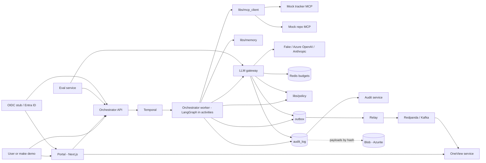
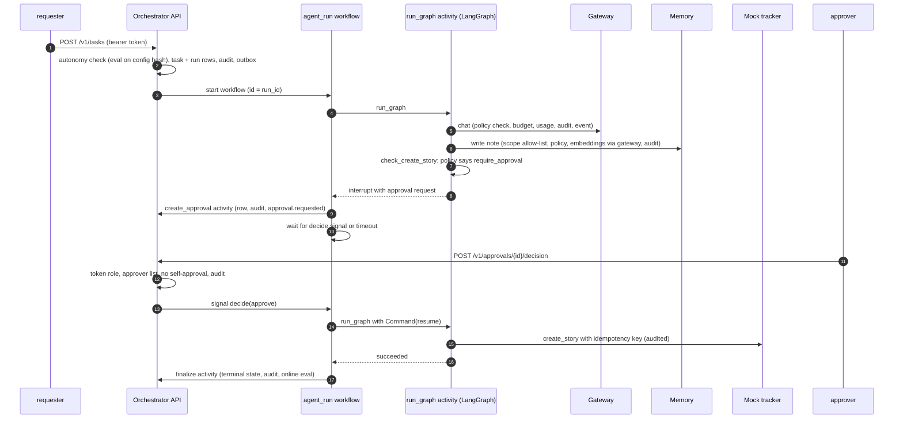
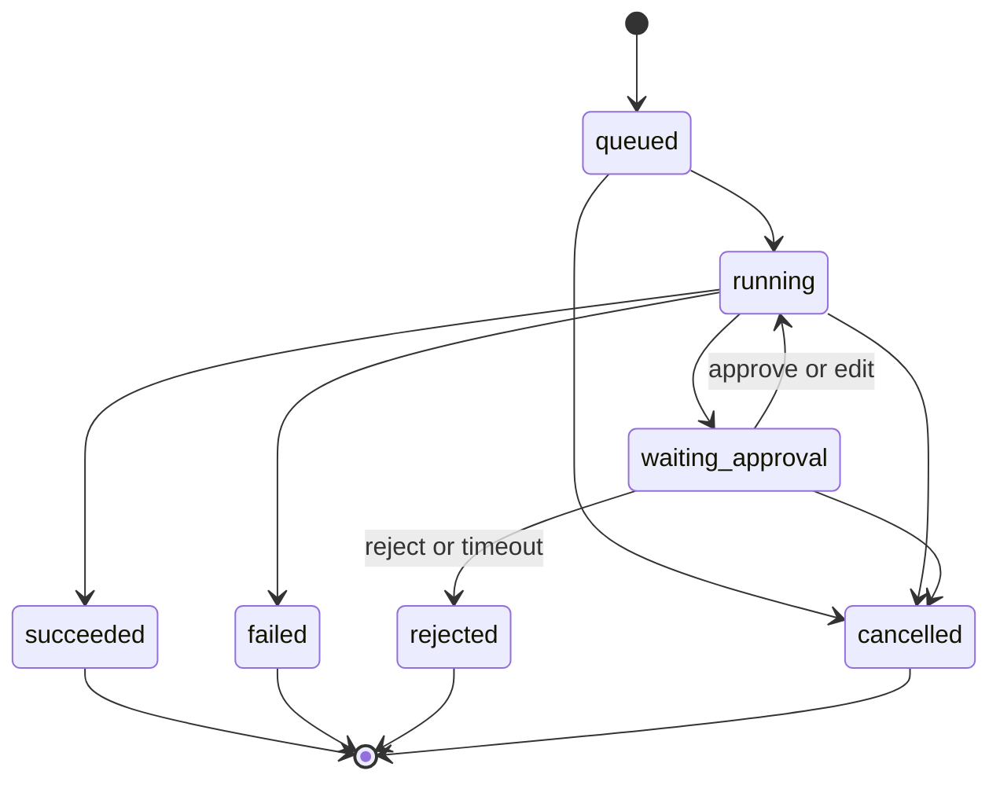
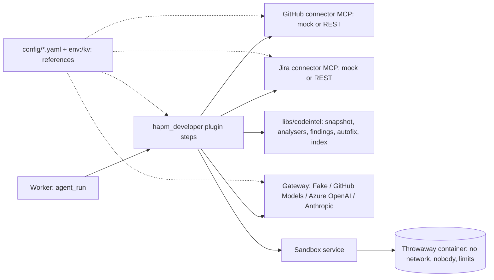
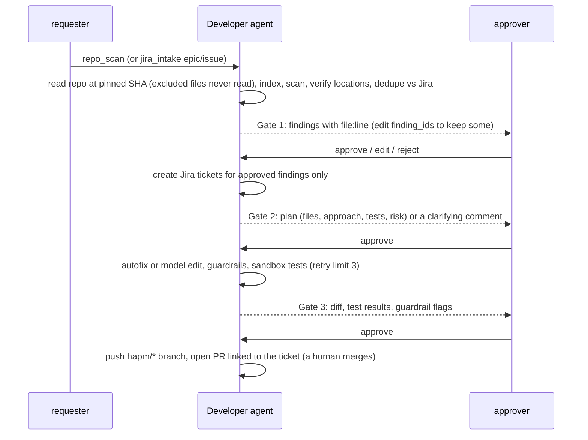

# HAPM architecture (Phase 0 Core)

HAPM is a shared Core that every studio agent runs on. An agent is a YAML file on top of the Core,
not a separate application. Phase 0 proves the Core with one harmless agent, `dummy_echo`.

## Components



| Component | Code | Role |
|---|---|---|
| LLM gateway | `services/gateway` | OpenAI-style `/v1/chat` and `/v1/embeddings`; alias routing with fallback; budgets; usage; redaction |
| Orchestrator | `services/orchestrator` | Task, run, approval and memory API; Temporal worker running the `agent_run` workflow |
| Audit | `services/audit` | Read-only audit queries and hash-chain verification |
| Eval | `services/eval` | Runs YAML suites through the orchestrator in eval mode; stores and emits scores |
| OneView | `services/oneview` | Kafka consumer into a read model; REST and server-sent events for the portal |
| Relay | `services/relay` | Publishes committed outbox rows to Kafka |
| OIDC stub | `services/oidc_stub` | Dev-only token issuer (Entra ID in cloud) |
| Portal | `apps/portal` | Sign-in, runs, live timeline, evals, approval inbox |
| Libraries | `libs/*` | core (settings, audit, governance, auth, scoring), policy, events, memory, mcp_client, telemetry |
| Mock MCP servers | `connectors/*` | Tracker and repo tools for Phase 0 |

## One run, end to end



## Run states



A terminal state is written with compare-and-set, so it can never change afterwards.

## Data model

```mermaid
erDiagram
  tasks ||--o{ runs : has
  runs ||--o{ approvals : has
  runs ||--o{ llm_usage : costs
  runs ||--o{ memory_records : "source_run_id"
  runs ||--o{ audit_log : "run_id"
  runs ||--o{ eval_results : "online scores"
  tasks { text id PK; text agent_id; text requester; jsonb input }
  runs { text id PK; text task_id FK; text state; text mode; text config_hash; text autonomy; jsonb output }
  approvals { text id PK; text run_id FK; text status; jsonb proposed_action; text decided_by; timestamptz expires_at }
  audit_log { bigserial seq PK; uuid id; text actor; text action; text decision; text policy_rule_id; text prev_hash; text row_hash }
  outbox { uuid id PK; text topic; jsonb payload; timestamptz published_at }
  llm_usage { bigserial id PK; text run_id; text provider; int prompt_tokens; numeric cost_usd }
  memory_records { text id PK; text scope; text scope_key; vector embedding; timestamptz expires_at }
  eval_results { text id PK; text kind; text agent_id; text config_hash; float aggregate; bool passed }
  oneview_events { bigserial seq PK; text event_id UK; text type; text subject; jsonb data }
```

Other tables: `processed_events` (consumer dedupe), `tracker_stories`, `tracker_comments`,
`repo_pull_requests` (mock connector data), and LangGraph's checkpoint tables.

Database roles: `hapm` owns the schema and runs migrations; `hapm_app` is used by services and
cannot update or delete audit rows; `hapm_readonly` is used by `make verify`.

## Events

| Topic | Event types |
|---|---|
| `runs.events` | `run.state_changed`, `run.step`, `run.tool_called`, `run.memory_accessed`, `run.policy_decided`, `eval.completed` |
| `approvals.events` | `approval.requested`, `approval.decided` |
| `audit.events` | `audit.recorded` |
| `llm.usage` | `llm.usage` |

One JSON Schema per type lives in `schemas/events`; `schemas/agent.schema.json` describes agent YAML.

## Phase 1: Developer agent





Agent definition: `agents/developer.yaml` (plugin and gate steps, ADR-0018). New tables: `findings`,
`code_chunks`, `code_index_state`, `sandbox_runs`, mock `jira_issues`, `jira_comments`,
`github_branches`, `github_pull_requests`; approvals gained an `approvers` column.

## Decisions

See `docs/adr/` (ADR-0001 to ADR-0019).
